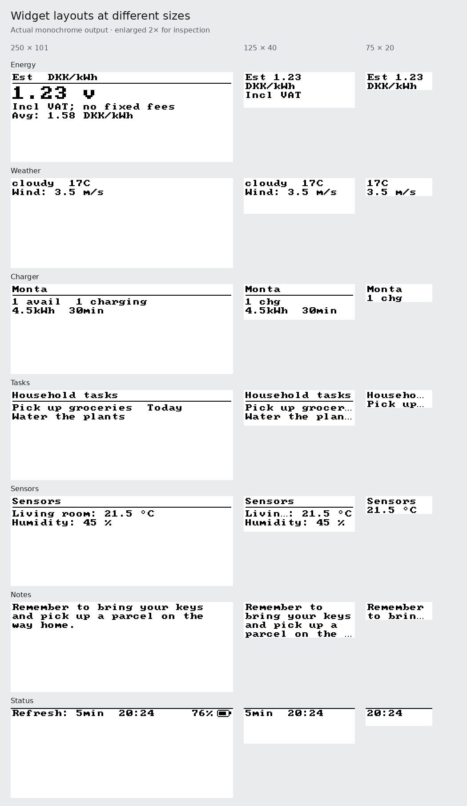

# Display text

The server's 8×8 bitmap font supports printable ASCII and these additional
characters in every widget and in both BMP and raw output:

- Danish: `æ ø å Æ Ø Å`.
- Accented Latin: `À Á Â Ã Ä È É Ê Ë Ì Í Î Ï Ñ Ò Ó Ô Õ Ö Ù Ú Û Ü Ý Ÿ`
  and `à á â ã ä è é ê ë ì í î ï ñ ò ó ô õ ö ù ú û ü ý ÿ`, plus `Ç ç ß`.
- Symbols: `° € £ ± × ÷`.
- Punctuation: `‘ ’ “ ” „ « » – — − … •` and non-breaking space.

Text is normalized to Unicode NFC, so `a` followed by a combining ring renders
the same as `å`. Wrapped text measures Unicode code points rather than UTF-16
units, preserves explicit paragraph breaks, and splits long words across lines
without dropping their remainder. Drawing remains clipped to each widget.
Ordinary spaces and tabs between words collapse to one space during wrapping;
non-breaking spaces remain inside a word.

Widgets share a two-pixel inset and a ten-pixel text rhythm in logical pixels,
scaled by the widget's text size. Labels that do not fit end in `…`; wrapped
notes mark continuation on their last complete line. A row that cannot fit a
whole glyph vertically is omitted. Weather and sensor summaries shorten labels
before readings and units, and narrow status bars fall back to the clock.
Monta, Zaptec, Notion and sensors use matching inset headings and dividers; the
divider is omitted in short, two-line widgets. Taller energy summaries enlarge
the price, while narrow summaries stack the price, unit and tax basis as space
allows. Very short battery widgets show the percentage alone.

Each unsupported code point draws one visible `?`. This font does not provide
full Unicode coverage, emoji, right-to-left layout, ligatures or script shaping.
Accented letters have compacted bodies to fit the same eight-pixel cell. The
additional glyphs are hand-drawn; no external font files are required.

## Display language

Widget wording comes from one catalog per language (`displayStrings.ts`), chosen by
the device's **Display language** (English or Danish). A test requires both catalogs
to have the same entries and to use only characters this font can draw, so a
translation cannot render as `?`. Danish uses `æ ø å`, which are in the font.

Month and weekday names are part of the catalog, not the runtime's locale data, so
the result does not depend on how Node was built. Clock times stay `HH:mm` in both
languages. See
[device workspaces](DEVICE_WORKSPACES.md#display-language).

The [Open Book's Unicode text support](https://www.oddlyspecificobjects.com/projects/openbook/)
inspired this focused improvement for Danish household data and European names.
